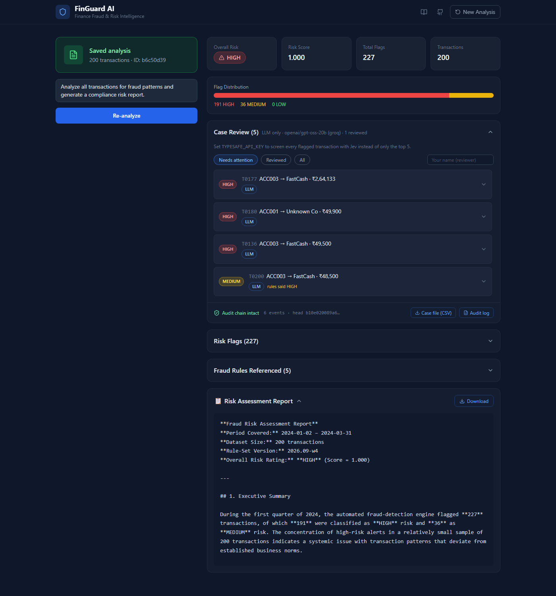
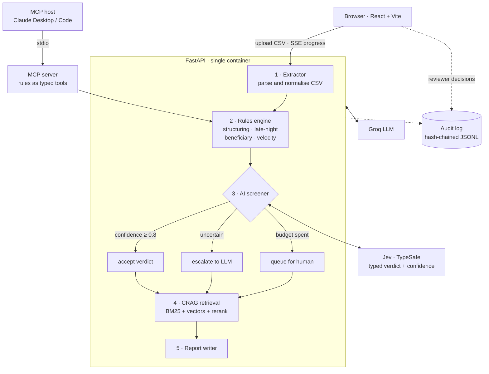
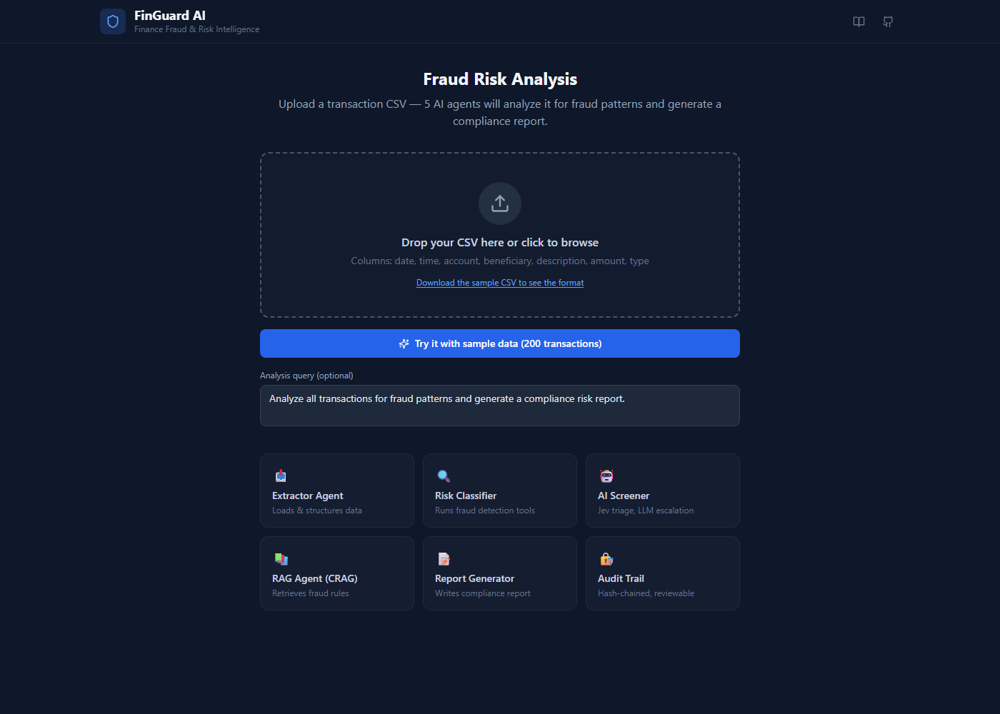
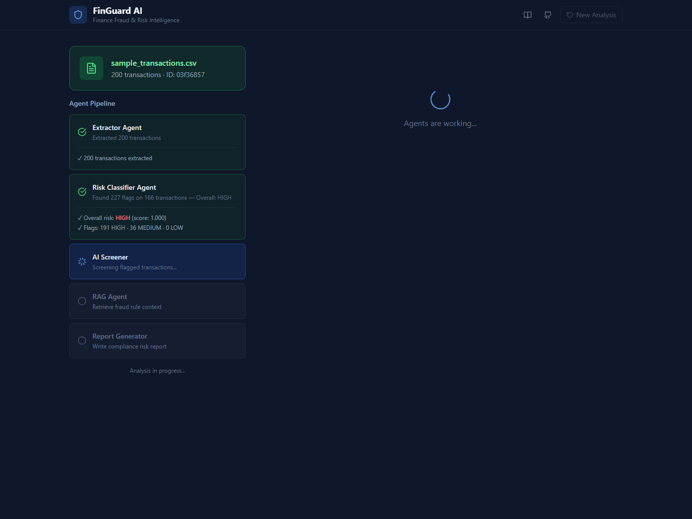

# 🛡️ FinGuard AI

**Multi-agent fraud triage for transaction data — with an audit trail a compliance team can hand to an examiner.**

[](https://github.com/Rishi-Is-Cool/Finguard/actions/workflows/week4-ci.yml)


Upload a bank-transaction CSV. Five agents run deterministic fraud rules, screen every
flagged transaction with a model, retrieve the relevant policy with corrective RAG, and
write a compliance report — streamed to the browser as each agent finishes. A reviewer
then confirms or dismisses each case, and every step is written to a hash-chained log
that detects any after-the-fact edit.



**[Run it locally in about two minutes →](#quick-start)** · no API key needed for the test suite, one free Groq key to run the app.

---

## Architecture



The frontend and API ship as **one container**: FastAPI serves the built React app at `/`
and the API at `/api`, so there is one URL and no CORS to configure in production.
Groq handles relevance grading, escalated classifications and the final report; the audit
log records every stage — the input hash, the ruleset version and its thresholds, each
model verdict with its confidence, the retrieved passages, and every reviewer decision.

### The screener is a cascade, not a single model

Rules are cheap and explainable but noisy — on the bundled sample they flag 166 of 200
transactions. Rather than send all of them to an LLM, step 3 triages:

| Condition | Route | Cost |
|---|---|---|
| Jev returns confidence ≥ `FINGUARD_JEV_CONFIDENCE` | accept the typed verdict | ~$0.00003 per transaction |
| Below the threshold, or the call failed | escalate to the LLM, worst first | LLM pricing, capped by budget |
| Escalation budget spent | queue for a human reviewer | free |

Without a `TYPESAFE_API_KEY`, step 3 skips Jev and behaves like Week 3: the LLM classifies
the top-N highest-severity transactions. Everything else works unchanged.

---

## Quick start

**Prerequisites:** Python 3.11, Node 22+, and a free [Groq API key](https://console.groq.com).

```bash
git clone https://github.com/Rishi-Is-Cool/Finguard.git
cd "Finguard/week 4"
```

<details open>
<summary><b>macOS / Linux</b></summary>

```bash
python3.11 -m venv .venv
.venv/bin/pip install torch --index-url https://download.pytorch.org/whl/cpu
.venv/bin/pip install -r backend/requirements.txt
cp .env.example .env                       # add your GROQ_API_KEY
(cd frontend && npm ci && npm run build)
.venv/bin/python -m uvicorn backend.main:app --port 7860
```
</details>

<details>
<summary><b>Windows (PowerShell)</b></summary>

```powershell
py -3.11 -m venv .venv
.venv\Scripts\pip install torch --index-url https://download.pytorch.org/whl/cpu
.venv\Scripts\pip install -r backend\requirements.txt
copy .env.example .env                     # add your GROQ_API_KEY
cd frontend; npm ci; npm run build; cd ..
.venv\Scripts\python -m uvicorn backend.main:app --port 7860
```
</details>

Then open **<http://localhost:7860/?demo>** — the `?demo` parameter runs the bundled
200-transaction sample end to end, about a minute.

> **Install torch from the CPU index first**, as shown. Otherwise `sentence-transformers`
> pulls the ~2.5 GB CUDA build, which this project never uses on CPU.

### Run the tests

From the same `week 4/` directory:

```bash
.venv/bin/pip install -r backend/requirements-dev.txt
.venv/bin/python -m pytest          # 42 tests, no API keys required
```

### Or use Docker

From the repository root:

```bash
docker build -t finguard "week 4"
docker run -p 7860:7860 -e GROQ_API_KEY=your_key finguard
```

The image reads `$PORT`, so it runs unchanged on Hugging Face Spaces, Render, Fly.io,
Railway or Cloud Run.

### Deploy your own

Again from `week 4/`:

```bash
hf auth login                                  # token with write access
.venv/bin/python deploy/hf_space.py --set-secrets
```

This creates a Hugging Face Docker Space, uploads an explicit allow-list of files (so
`.env` can never ship), and copies your API keys into the Space's secrets. The first
build takes 8–10 minutes. The free CPU tier's 16 GB RAM comfortably fits the two
transformer models; 512 MB free tiers elsewhere do not.

### Use it from an AI agent

The rules engine is also an [MCP](https://modelcontextprotocol.io) server — no API key,
deterministic output. Add to Claude Desktop or `.mcp.json`:

```json
{
  "mcpServers": {
    "finguard": {
      "command": "/absolute/path/to/week 4/.venv/bin/python",
      "args": ["-m", "backend.mcp_server"],
      "env": { "PYTHONPATH": "/absolute/path/to/week 4" }
    }
  }
}
```

Then ask: *"Screen transactions.csv with finguard and summarise the worst accounts."*

---

## What's interesting here

- **Rules and models disagree, on purpose.** The rules flag 83% of the sample and
  saturate the risk score. The model layer's job is to push back — in one run it
  downgraded a ₹49,800 "EMI debit" that the rules called structuring. Disagreements are
  surfaced in the UI and routed to a human, not hidden.
- **Tamper-evident audit trail.** Each event carries the SHA-256 of the one before it.
  Editing, deleting or reordering any past entry is detected, and the exported case file
  is rebuilt from the log rather than from memory.
- **A real bug, found by deploying.** The Week 3 retrieval layer shared one vector
  collection across requests, so one user's transactions could surface in another user's
  report. Invisible with a single local user; serious on a public URL. Reproduced, fixed
  with per-run collections, and written up.
- **Honest about the model.** `/health` reports the model that will *actually* serve, not
  the one configured — the fine-tuned 8B classifier needs a ≥18 GB GPU, so on CPU hosts
  the app says so and falls back to Groq instead of failing at the first request.

## Repository layout

Each week is self-contained and runnable on its own.

| Week | Built | Key ideas |
|---|---|---|
| [1](week%201/) | RAG over bank statements + rule-based detection (Streamlit) | Hybrid retrieval, routing between a pandas agent and RAG |
| [2](week%202/) | LangGraph multi-agent pipeline with human-in-the-loop and memory | Agent state, SQLite checkpointing, LangSmith tracing |
| [3](week%203/) | QLoRA fine-tuned Llama-3.1-8B classifier, CRAG, FastAPI + React with live SSE | Fine-tuning, corrective RAG, streaming UIs, capacity-aware fallback |
| **[4](week%204/)** | **Deployment, audit trail, human review, Jev cascade, MCP server, tests + CI** | **Containers, hardening, observability for humans** |

```
week 4/
├── backend/        FastAPI app, rules engine, CRAG, Jev client, MCP server, audit log
├── frontend/       React + Vite + Tailwind, SSE streaming UI, reviewer workflow
├── tests/          42 tests — rules, audit chain, Jev contract, cascade routing, API, MCP
├── deploy/         one-command Hugging Face Spaces deployment
├── portfolio/      case study and write-up
└── Dockerfile      frontend build + API in a single image
```

**[week 4](week%204/) is the complete system** — its README covers the audit design, the
cascade thresholds, the full API reference, and the known limitations.

## Stack

FastAPI · React + Vite + Tailwind · LangChain · Chroma + BM25 hybrid retrieval with a
cross-encoder reranker · Groq · Jev (TypeSafe) · QLoRA / PEFT · MCP · Docker ·
Hugging Face Spaces · GitHub Actions

## Screens

| Landing | Agents streaming |
|---|---|
|  |  |

## Limitations

The rules over-flag by design and the aggregate risk score saturates on the sample;
LLM verdicts vary between runs, which is why each one is recorded rather than trusted;
reviewer names are self-asserted rather than bound to SSO; and uploads are held in memory
in a single process. [week 4's README](week%204/#known-limitations) documents each one and
what a production version would need.

## License

MIT — see [LICENSE](LICENSE).
