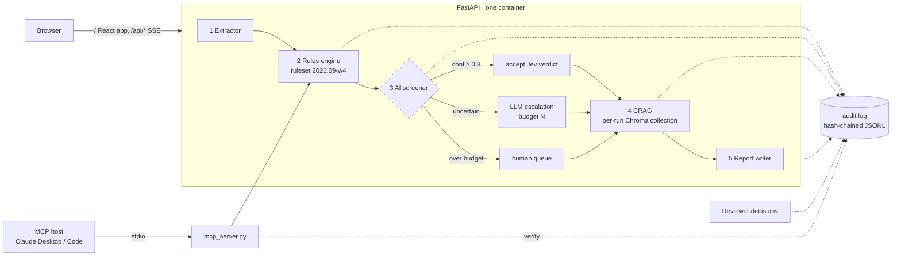

# 🛡️ FinGuard AI — Week 4 (Days 22–30)

**Deployed, auditable, and callable by other agents.**

Weeks 1–3 built the detector: rules, a multi-agent pipeline, corrective RAG and a
fine-tuned classifier. Week 4 makes it something a compliance team could actually
put in front of an examiner, and something anyone can open from a link.

| New in Week 4 | Why it matters |
|---|---|
| **Hash-chained audit trail** | Every step — input hash, rule version and thresholds, each model verdict with its confidence, retrieved context, the report, every human decision — is an append-only event carrying the hash of the one before it. Altering any past line is detected. |
| **Human review + case file** | Reviewers mark each flagged transaction *confirmed fraud / false positive / escalate* with a note. One click exports the case file (CSV) rebuilt from the audit log. |
| **Jev confidence-gated cascade** | [Jev](https://docs.typesafe.ai) (TypeSafe's "System One" model) screens *every* flagged transaction for fractions of a cent. Confident verdicts are accepted; uncertain ones escalate to the LLM; overflow goes to a human queue. |
| **MCP server** | The rules engine, fraud policy and audit verification are tools any MCP host (Claude Desktop, Claude Code, Cursor, agent frameworks) can call. Typed outputs, no API key. |
| **One-container deployment** | FastAPI serves the built React app at `/` and the API at `/api`. One Dockerfile, one URL. Deploys to Hugging Face Spaces with one command. |
| **Public-demo hardening** | Upload size and row caps, per-IP rate limit on `/analyze`, bounded in-memory stores, path-safe document ids. |
| **Tests + CI** | 42 tests, no API keys needed. CI builds the Docker image and smoke-tests the running container. |

---

## Architecture



Without a `TYPESAFE_API_KEY` step 3 behaves exactly like Week 3: the LLM (or the
fine-tuned model on a big enough GPU) classifies the top-N HIGH transactions.

---

## Run it

### Development (hot reload, two terminals)
```bash
cd "week 4"
python -m venv .venv
.venv/Scripts/pip install torch --index-url https://download.pytorch.org/whl/cpu
.venv/Scripts/pip install -r backend/requirements.txt -r backend/requirements-dev.txt
cp .env.example .env        # add GROQ_API_KEY
.venv/Scripts/python -m uvicorn backend.main:app --reload --port 8000
```
```bash
cd "week 4/frontend" && npm ci && npm run dev      # http://localhost:5173
```
(On macOS/Linux use `.venv/bin/` instead of `.venv/Scripts/`.)

### Production mode locally (exactly what the container runs)
```bash
cd "week 4/frontend" && npm run build
cd .. && .venv/Scripts/python -m uvicorn backend.main:app --port 7860
```
Open http://localhost:7860, or **http://localhost:7860/?demo** to run the sample
automatically — the link to send people.

### Tests
```bash
cd "week 4" && .venv/Scripts/python -m pytest
```

---

## Deploy

### Hugging Face Spaces (free CPU tier: 2 vCPU, 16 GB RAM)
```bash
hf auth login                                   # token with write access
.venv/Scripts/python deploy/hf_space.py         # creates <you>/finguard-ai
```
Then add `GROQ_API_KEY` (and optionally `TYPESAFE_API_KEY`) under the Space's
**Settings → Variables and secrets**, or re-run with `--set-secrets` to copy them
from `.env`. The first build takes ~8–10 minutes. The script uploads an explicit
allow-list of files, so `.env` can never be shipped.

Why Spaces over Render/Railway free tiers: the backend holds two transformer models
in memory (MiniLM embeddings + a cross-encoder reranker). 512 MB free tiers are
too tight; Spaces' 16 GB is not.

### Any Docker host
The image reads `$PORT`, so it runs unchanged on Render, Fly.io, Railway or Cloud Run:
```bash
docker build -t finguard "week 4"
docker run -p 7860:7860 -e GROQ_API_KEY=... finguard
```

### Split deployment (frontend on Vercel/Netlify, API elsewhere)
Build the frontend with `VITE_API_URL=https://your-api.example.com` and set
`FINGUARD_CORS_ORIGINS` on the API to the frontend's origin.

---

## Jev cascade

Each flagged transaction becomes one Jev request whose `state` holds the transaction
*and the written fraud policy*, with two questions answered in the same pass:

- `risk` — a **Choice** over HIGH / MEDIUM / LOW, returning probabilities and a calibrated confidence
- `legitimate_explanation` — a **Noul**: does the description give a plausible legitimate reason (EMI, salary, rent…)?

Routing, with every threshold an env var:

| Condition | Route |
|---|---|
| confidence ≥ `FINGUARD_JEV_CONFIDENCE` (0.8) | **auto** — accept Jev's verdict; reasoning records its probabilities and the rules that fired |
| below threshold, or the call failed | **LLM** — up to `FINGUARD_CLASSIFY_TOP_N` escalations, worst rule severity first |
| escalation budget spent | **human queue** |

Jev is billed on input tokens only ($0.042 per million for jev-1.13). Each request
carries the transaction plus the policy, roughly 650 tokens, so screening the
sample's 166 flagged transactions is an estimated ~110k tokens ≈ $0.005. The app
reports the exact figure from Jev's `usage` field after every run.

**Verification status.** The client is written against TypeSafe's published HTTP
reference (`POST /v1/systemone`, Bearer auth, 429/529 retry with `retry-after`) and
tested against responses shaped exactly like its documented examples, including a
full end-to-end UI run against a local stand-in. It has **not** been run against the
live Jev API — that needs a key. Tune the confidence threshold on your own labelled
data before trusting auto-routing; TypeSafe's own guidance is to start conservative.

---

## Audit trail

One JSONL file per analysis in `FINGUARD_AUDIT_DIR`:

| Event | Records |
|---|---|
| `input_received` | filename, SHA-256 of the exact bytes uploaded, row count |
| `rules_applied` | ruleset version *and thresholds*, every flag, every flagged transaction |
| `model_screening` | per transaction: route, verdict, model, confidence, probabilities, reasoning |
| `context_retrieved` | the CRAG query, whether it was rewritten, the passages used |
| `report_generated` | model, SHA-256 of the prompt and the report, the report |
| `human_review` | reviewer, decision, note |

Each event is `{seq, ts, type, actor, payload, prev_hash, hash}` with
`hash = sha256(canonical_json(everything but hash))`. `GET /api/audit/{id}/verify`
recomputes the chain; editing, deleting or reordering any line reports where it broke.

**Limits, stated plainly:** reviewer names are self-asserted (production would bind
them to SSO), and hash-chaining proves integrity *relative to the head hash* — to
make it tamper-evident against the server operator too, periodically anchor the head
somewhere they don't control. Free hosting disks are ephemeral; point
`FINGUARD_AUDIT_DIR` at persistent storage for real use.

---

## MCP server

```bash
python -m backend.mcp_server        # stdio; run from week 4/, or set PYTHONPATH to it
```

| Tool / resource | Does |
|---|---|
| `check_transaction` | per-transaction rules on one transaction |
| `screen_transactions` | all rules, including account velocity, on a batch |
| `screen_csv` | the same, on a local CSV path |
| `verify_audit_trail` | recompute an analysis's hash chain; list human decisions |
| `finguard://policy` | the written policy plus exact thresholds |

Add it to Claude Desktop (`claude_desktop_config.json`) or a Claude Code project
(`.mcp.json`) — same shape:
```json
{
  "mcpServers": {
    "finguard": {
      "command": "C:/path/to/week 4/.venv/Scripts/python.exe",
      "args": ["-m", "backend.mcp_server"],
      "env": { "PYTHONPATH": "C:/path/to/week 4" }
    }
  }
}
```
Then ask: *"Screen C:/…/transactions.csv with finguard and summarise the worst accounts."*

---

## API

Served at both `/x` and `/api/x`. Interactive docs at `/docs`.

| Method | Path | |
|---|---|---|
| POST | `/upload` | CSV upload → `document_id` |
| POST | `/upload/sample` | load the bundled 200-transaction sample |
| GET | `/sample.csv` | download the sample (shows the format) |
| POST | `/analyze` | run the pipeline; Server-Sent Events |
| GET | `/report/{id}` · `/flags/{id}` · `/status/{id}` | results |
| GET | `/audit/{id}` · `/audit/{id}/verify` · `/audit/{id}/export.csv` | audit trail, chain check, case file |
| POST / GET | `/review/{id}` | record / list human decisions |
| GET | `/health` | the models that will *actually* serve, not just the configured ones |

---

## Fixed from Week 3

| Problem | Effect | Fix |
|---|---|---|
| Every `build_crag()` wrote into Chroma's default collection in a process-wide client | **One user's transactions were retrievable in the next user's report** (reproduced before fixing) | Unique collection per run, dropped afterwards |
| Embedding + reranker models reloaded on every request | Seconds of latency and memory churn per analysis | Loaded once, warmed in the background at startup |
| CRAG and report LLM calls ran on the event loop | One analysis froze every other request, health checks included | Moved to worker threads |
| Velocity flags were attached to `transactions[0]` | An unrelated transaction carried the flag — unacceptable in an audit trail | Recorded as account-level flags |
| Chroma usage telemetry on by default | A finance app phoning home | Disabled |

## Known limitations

- **The rules over-flag.** The sample yields 227 flags on 166 of 200 transactions and the
  risk score saturates at 1.000, so "overall risk" carries little information. This is
  what the screener and human review exist to absorb — and the next thing to tune.
- **LLM verdicts vary run to run.** Two identical runs had the LLM confirm 4/5 and then
  3/5 of the same rule-HIGH transactions. Treat single LLM verdicts as opinions; the
  audit trail records which one was given.
- **Single process.** Analyses and uploads live in memory (bounded to 100); run one
  worker, or move them to Redis/Postgres to scale out.
- The fine-tuned model still needs a ≥18 GB GPU (see Week 3); everything else runs on CPU.

---

## Learnings (Days 22–30)

| Day | Topic | Where |
|---|---|---|
| 22 | Containerising an ML app: CPU torch wheels, baking model weights into the image | `Dockerfile` |
| 23 | Same-origin deployment, SPA + API in one process | `backend/main.py` (router mounted twice) |
| 24 | Hardening a public demo: size caps, rate limits, trusting `X-Forwarded-For` correctly | `backend/main.py` |
| 25 | Tamper-evident logging with hash chains | `backend/audit.py` |
| 26 | Human-in-the-loop review as data, not UI state | `/review`, `CaseReview.jsx` |
| 27 | Model cascades and confidence-gated routing | `backend/jev.py`, `classifier.run_cascade` |
| 28 | Exposing tools over MCP with typed outputs | `backend/mcp_server.py` |
| 29 | Testing without API keys: contract fixtures, mock transports, in-process MCP clients | `tests/` |
| 30 | CI that builds and boots the real image | `.github/workflows/week4-ci.yml` |
